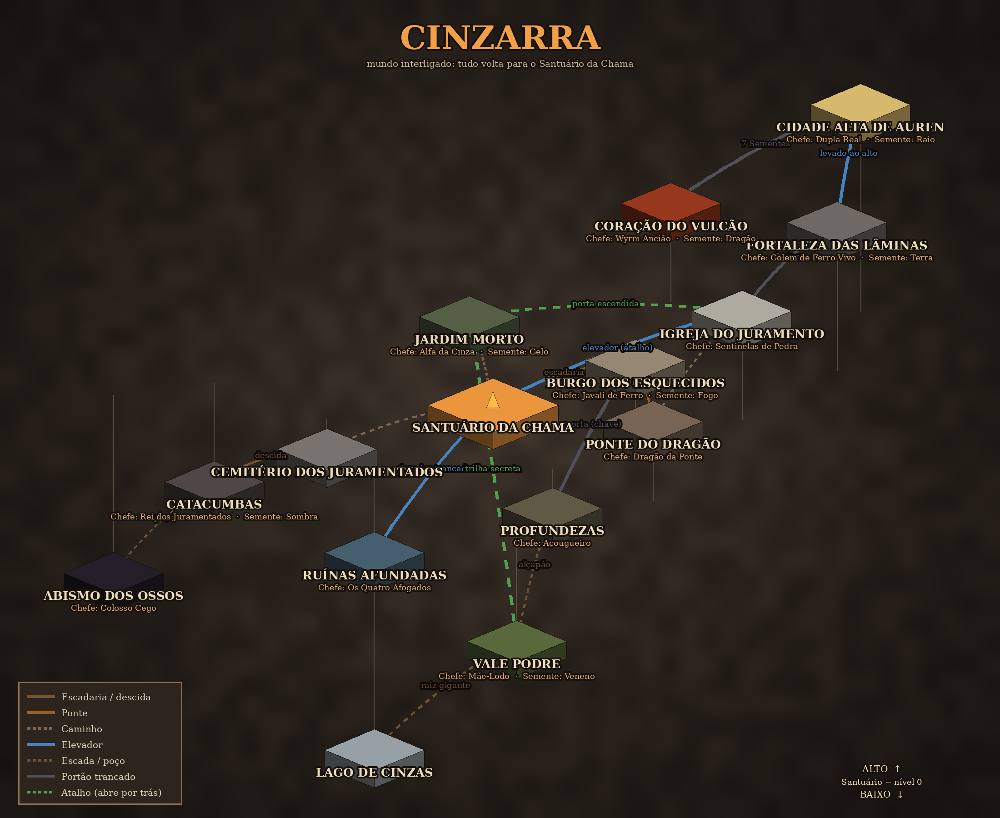

# Mapa oficial — Cinzarra

> Status: **proposta v2, aguardando aprovação do dono do jogo** (2026-10-21).
> A v1, uma ilha aberta com estradas, foi recusada: o dono quer um mundo "mais parecido com o mapa de Dark Souls".
> Dados: `prototypes/souls3d-concept/map/official_map.json` (a mesma fonte alimenta o desenho e o construtor do mundo).
> Desenho: `design/levels/mapa-oficial.png` (gerado por `prototypes/souls3d-concept/tools/draw_map.py`).

## Ideia

Copiamos a **estrutura** do mapa de Dark Souls, não os nomes nem os lugares:

- **Um santuário no centro.** O Santuário da Chama é a fogueira principal, com NPCs e o Altar das Sementes.
  Todo o resto se liga a ele.
- **Mundo em camadas.** Áreas ficam **acima** (Burgo, Igreja, Fortaleza, Cidade Alta) e **abaixo**
  (Cemitério, Catacumbas, Abismo, Ruínas Afundadas, Profundezas, Vale Podre, Lago de Cinzas) do santuário.
  Dá para ver lugares de cima e de baixo antes de chegar neles.
- **Tudo interligado.** O jogador descobre o caminho de volta abrindo atalhos por trás:
  - o elevador da Igreja desce até o Santuário;
  - uma porta escondida liga o Jardim Morto à Igreja;
  - uma trilha secreta liga o Vale Podre ao Jardim.
- **Poucas fogueiras, bem espaçadas.** O atalho aberto vale mais que a fogueira.
- **Portões e chaves:**
  - os 2 Sinos do Despertar (um no alto, na Igreja; outro no fundo, no Vale Podre) abrem a Fortaleza;
  - a porta das Profundezas abre com chave;
  - o elevador das Ruínas Afundadas está trancado;
  - o portal final pede as 7 Sementes.
- **Aviso cedo:** o Cemitério fica logo ao lado do Santuário, com esqueletos fortes demais para o começo.
  Ele mostra que há outro caminho, como em Dark Souls.

## Ordem da aventura

1. **Santuário da Chama**: você chega, acende a fogueira e conhece a Guardiã.
2. **Burgo dos Esquecidos**: subindo a escadaria. Chefe **Javali de Ferro**, Semente do Fogo.
3. **Ponte do Dragão**: o dragão queima quem atravessa. Você passa correndo e volta mais tarde.
4. **Igreja do Juramento**: chefe **Sentinelas de Pedra**, 1º Sino. Abre o elevador para o Santuário.
5. **Profundezas** e depois **Vale Podre**: a descida ao fundo. Chefes **Açougueiro** e **Mãe-Lodo**,
   Semente do Veneno e 2º Sino.
6. **Fortaleza das Lâminas**: armadilhas. Chefe **Golem de Ferro Vivo**, Semente da Terra.
7. **Cidade Alta de Auren**: o ponto mais alto. Chefe **Dupla Real**, Semente do Raio.
8. **Jardim Morto**: em qualquer momento; é mais fácil cedo. Chefe **Alfa da Cinza**, Semente do Gelo.
9. **Catacumbas** e depois **Abismo dos Ossos**: escuridão. Chefe **Rei dos Juramentados**, Semente da Sombra.
10. **Ruínas Afundadas**: fantasmas que só a Semente da Sombra fere. Chefe **Os Quatro Afogados**.
11. **Coração do Vulcão**: o portal abre com as 7 Sementes. Chefe final **Wyrm Ancião**, Semente do Dragão.
12. Segredo: **Lago de Cinzas**, no fundo do mundo, por uma raiz gigante a partir do Vale Podre.

## Áreas

| Área | Altura | Mecânica | Ligações |
|---|---|---|---|
| Santuário da Chama | 0 | Fogueira central, ferreiro, Altar das Sementes | quase tudo |
| Burgo dos Esquecidos | +1 | Escadarias, telhados, inimigos emboscados | Santuário, Ponte, Profundezas (porta) |
| Ponte do Dragão | +1.5 | Dragão que varre a ponte com fogo; correr de abrigo em abrigo | Burgo, Igreja |
| Igreja do Juramento | +2 | Sino no telhado; elevador-atalho | Ponte, Santuário, Jardim, Fortaleza |
| Fortaleza das Lâminas | +3 | Pêndulos, bolas de pedra, pisos falsos | Igreja (2 sinos), Cidade |
| Cidade Alta de Auren | +4 | Arqueiros gigantes, telhados altos | Fortaleza, Coração do Vulcão |
| Jardim Morto | 0 | Floresta, névoa, lobos | Santuário, Igreja, Vale Podre |
| Cemitério dos Juramentados | −0.5 | Esqueletos fortes (aviso cedo) | Santuário, Catacumbas |
| Catacumbas | −2 | Ossos que ressurgem; só o fogo os mata de vez | Cemitério, Abismo |
| Abismo dos Ossos | −3.5 | Escuridão total; tocha ou Semente para ver | Catacumbas |
| Ruínas Afundadas | −1.5 | Cidade inundada, fantasmas | Santuário (elevador trancado) |
| Profundezas | −1 | Esgotos, ratos gigantes | Burgo, Vale Podre |
| Vale Podre | −2.5 | Favela de madeira num poço; água envenena | Profundezas, Jardim, Lago |
| Lago de Cinzas | −4.5 | Segredo calmo, dragão ancestral pacífico | Vale Podre |
| Coração do Vulcão | +2 | Lava, chuva de fogo | Cidade (7 Sementes) |

## Plano técnico (celular)

- Cada área é uma **cena separada**, carregada quando o jogador chega perto e descarregada quando ele se afasta.
  As ligações (escadas, elevadores, portas) são os pontos de troca.
- Nas bordas, uma versão leve das áreas vizinhas fica visível, para dar a sensação de mundo contínuo
  (ver a Igreja lá em cima, o Vale lá embaixo).
- Limites por quadro: até 200 mil triângulos, 250 chamadas de desenho e 12 luzes ligadas.

## Ordem de construção proposta

1. Santuário da Chama, Burgo e Igreja, com o elevador-atalho funcionando: é o primeiro "loop" ao estilo Dark Souls.
2. Ponte do Dragão; depois Profundezas e Vale Podre (a descida e o 2º Sino).
3. As áreas restantes, uma por vez, cada uma com seu chefe, sua Semente e seu segredo.
